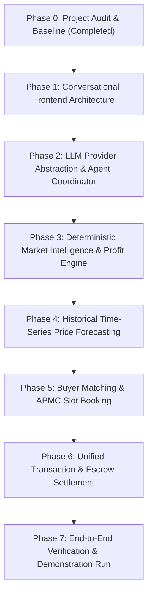

# PROJECT AUDIT: AgriMart-Market-Intelligence
**Audit Date**: October 2026  
**Auditor**: Senior Systems & Full-Stack Architect  
**Target System**: AgriMart Market Intelligence (Foundation for AgriMart Agentic AI)  
**Deliverable Category**: Phase 0 — Existing Project Audit & Integration Plan

---

## 1. Executive Summary

This audit establishes the baseline of `AgriMart-Market-Intelligence`, the extracted foundation for `AgriMart Agentic AI`. The goal of the upcoming development cycle is to transform this terminal-centric application into a **conversational-first marketplace**, where an intelligent AI assistant serves as the primary conversational interface while the full AgriStock Market Terminal remains accessible as a secondary module.

The audit evaluates:
1. Reusable components across frontend and backend.
2. Verified active backend APIs.
3. Live vs. Seeded vs. Mock datasets.
4. Missing integrations and architectural gaps.
5. Integration roadmap spanning Phases 1 through 7.

---

## 2. Component Inventory & Reusability Matrix

### 2.1 Backend Applications

| Application | Existing Capabilities | Audit Assessment | Reusability in Agentic AI |
|---|---|---|---|
| `users` | `CustomUser`, `FarmerProfile`, `MerchantProfile`, SimpleJWT auth, register, login, me endpoints. | **Production-Ready & Fully Working**. Validated password hashing (Argon2/PBKDF2), profile schema, and role-based permissions. | **High (100%)**: Used directly for assistant authentication, role extraction (Farmer vs Merchant), and user context injection. |
| `mandi` | `APMC`, `Commodity`, `DailyTicker`, `AuctionLot`, `MerchantBid`, `Settlement`. Row-locking bids (`select_for_update`), moisture discount calculations. | **Fully Functional Model & API Layer**. Seeded with 6 real APMCs, 10 standardized commodities, and active lots. Bidding logic enforces idempotency. | **High (100%)**: Serves as the primary operational data layer for Market Intelligence tools, Order Book analysis, and Bidding tools. |
| `common` | `AuditLog`, `OutboxEvent`, `IdempotencyKey`, security headers middleware, request tracing. | **High-Reliability Enterprise Core**. Zero dependencies on e-commerce. Idempotency reservation and outbox event publishing active. | **High (100%)**: Critical for financial operation idempotency in agentic tool execution (booking, bidding, settlements). |
| `realtime` | FastAPI gateway with `/api/v1/mandi/bid`, `/ws/mandi/auction/{id}`, `/ws/mandi/feed`, Redis sliding-window limiter. | **Operational High-Frequency Gateway**. Verified standalone gateway for low-latency market ticks and auction streams. | **High (90%)**: Will stream realtime ticks and auction events to the frontend and conversation state. |

### 2.2 Frontend Components

| Component | Existing Role | Audit Assessment | Target Role in Agentic AI |
|---|---|---|---|
| `SkanviLoginPage.jsx` | Dual-mode Scandinavian login & registration page with demo shortcuts. | Fully functional; authenticates against Django JWT backend and stores tokens in `localStorage`. | **Retained as Primary Auth Screen**; redirects authenticated users to the new conversational assistant homepage. |
| `AgriStockExchangeView.jsx` | 2,500+ line terminal: 1D/1W/1M/1Y chart canvas, 5-level depth book, spread, LTP, Agmarknet benchmarks, contract notes & escrow ledger, arrivals radar, auction desk. | Comprehensive, highly styled, responsive. Reuses mock data for transactions and simulated canvas for charts. | **Preserved as Secondary Module ("Market Terminal")**. Accessible via sidebar, navbar, and AI assistant deep-link actions (`NAVIGATE_TO_TERMINAL`). |
| `MandiTicker.jsx` | Top real-time rolling ticker bar for national APMC commodity rates. | Clean, dynamic ticker displaying commodity price, % delta, day high/low. | **Retained**: Mounted at the top of both the Assistant and Terminal interfaces. |
| `Navbar.jsx` | Header with brand, search modal trigger, market tabs, user session pill, logout. | Configured for standalone market intelligence; no store/rental links. | **Refactored**: Updated to include AI Assistant toggle, conversation switcher, and direct Terminal navigation. |
| `SearchModal.jsx` | Commodity and APMC mandi search modal (`Cmd+K`). | Real-time fuzzy filtering over commodities and mandis. | **Preserved & Integrated**: Can be triggered manually or programmatically by the assistant. |
| `Footer.jsx` | Market intelligence footer with APMC hubs and clearing disclosures. | Fully styled and clean. | **Preserved** across views. |

---

## 3. Data Integrity & Reality Audit

To adhere to Non-Negotiable Rule 24 (*"Do not fabricate market data. Do not fabricate buyer demand. Do not generate fake forecasts."*), the exact state of all datasets has been mapped:

### 3.1 Price Data: Real vs. Seeded vs. Mock
* **APMC Mandis (`mandi_apmc`)**: **Seeded with Real World Entities**. 6 major APMCs (Ludhiana, Alwar, Rajkot, Karnal, Indore, Guntur) with accurate geographical coordinates and official market codes.
* **Commodities (`mandi_commodity`)**: **Seeded with Official Benchmarks**. 10 agricultural commodities (Wheat Sharbati, Mustard, Cotton Shankar-6, Basmati Paddy 1121, Yellow Soybean, Teja Chilli, Sona Masoori, PR-106 Paddy, Yellow Mustard, Desi Chana) with statutory standard MSP rates and official AGMARKNET modal rates.
* **Daily Tickers (`mandi_dailyticker`)**: **Seeded Snapshot**. Contains current-day modal price, min price, max price, and arrivals volume sourced from AGMARKNET benchmarks.
* **Historical Time-Series**: **Currently Insufficient for Production ML Forecasting**. In the extracted database, only single daily snapshots exist. The frontend 1D/1W/1M/1Y charts currently utilize algorithmic synthetic fluctuations.
  * *Audit Mandate for Phase 4*: To support genuine time-series forecasting (ARIMA / SARIMAX / baseline), we must load authentic historical Agmarknet daily price records (90 to 365 daily observations per target commodity) into `DailyTicker` so forecasting models evaluate real historical trends.

### 3.2 Buyer Accounts & Demand Representation
* **Database State**: Only 1 merchant account is seeded in `users_customuser` (`Rajkot Agri-Exports Pvt Ltd`, Phone: `9123456780`, APMC License: `GJ-RJK-2024-8841`).
* **Frontend Mock State**: `SAMPLE_CONTRACT_TRANSACTIONS` in `mockData.js` references external buyers ("ITC Agri Business Division", "Cargill Animal Nutrition", "KRBL Limited", "Adani Wilmar Ltd", "Vardhman Textiles").
* *Audit Mandate for Phase 5*: Real buyer matching cannot depend on hardcoded string lists. We will seed authentic institutional merchant profiles with verified APMC licenses, targeted commodity demand, credit limits, and purchase capacity in the database so the `buyer_matching` engine matches against real database records.

### 3.3 Slot Booking Implementation
* **Current State**: **NOT IMPLEMENTED in Backend**.
* *Audit Mandate for Phase 5*: Create a dedicated `bookings` Django app with:
  * `DeliverySlot` model (APMC, Date, Time Window, Max Vehicle Capacity, Available Capacity).
  * `SlotBooking` model (Farmer, Commodity, Quantity, Vehicle No, Status, Idempotency Key).
  * Strict database transaction locking (`select_for_update`) to prevent double-booking.

### 3.4 Payment, Escrow & Settlement Verification
* **Current State**: Application-level escrow simulation.
  * In `backend/mandi/models.py`, `Settlement` computes gross amount, moisture deductions, platform fees, and escrow reserve fees.
  * In `frontend/src/data/mockData.js`, contract transactions display simulated bank references (e.g. `ESC-AXIS-683553`).
  * Live external payment gateway (e.g. Razorpay Route / Cashfree Escrow API) is **not connected**.
* *Audit Mandate for Phase 6*: The application must not claim live banking integration if only an internal ledger exists. We will implement a structured, verifiable internal escrow lifecycle (`ESCROW_PENDING` &rarr; `ESCROW_SECURED` &rarr; `WEIGHMENT_VERIFIED` &rarr; `SETTLED`) with unique cryptographic verification hashes and provider simulation endpoints.

---

## 4. Architectural Gap Analysis & New Modules Required

To achieve the complete AgriMart Agentic AI specification, the following new modules must be constructed:

```
AgriMart-Market-Intelligence/
├── backend/
│   ├── ai/                            # [NEW] Agentic AI Core
│   │   ├── config/llm_config.py       # Configurable LLM provider settings
│   │   ├── llm/                       # Provider abstraction (Gemini, OpenRouter, OpenAI-compatible)
│   │   ├── agents/                    # Coordinator agent and specialized delegates
│   │   ├── tools/                     # Market, Liquidity, Bidding, Booking, Profit tools
│   │   └── forecasting/               # Time-series forecasting engine
│   ├── analytics/                     # [NEW] Deterministic Business Engines
│   │   ├── profit_calculator.py       # Formulaic net proceeds & expenses engine
│   │   ├── mandi_comparison.py       # Multi-APMC comparative ranking engine
│   │   ├── buyer_matching.py          # Database-driven buyer discovery engine
│   │   └── liquidity_analysis.py      # Order depth & bid/ask spread calculator
│   ├── conversations/                 # [NEW] Conversation memory, threads, messages
│   ├── bookings/                      # [NEW] APMC delivery slot booking engine
│   └── transactions/                  # [NEW] Unified market transaction lifecycle
```

And in the frontend:
```
AgriMart-Market-Intelligence/
├── frontend/src/
│   ├── pages/
│   │   ├── AssistantPage.jsx          # [NEW] ChatGPT-style conversational default homepage
│   │   ├── MarketTerminalPage.jsx     # Preserved AgriStockExchangeView
│   │   └── TransactionsPage.jsx       # Dedicated contract notes & escrow tracking
│   ├── assistant/                     # [NEW] Conversational UI & Interactive Response Cards
│   │   ├── ChatWindow.jsx
│   │   ├── ChatInput.jsx
│   │   ├── MessageList.jsx
│   │   ├── ConversationSidebar.jsx
│   │   └── cards/                     # Rich interactive visual response components
│   │       ├── CommodityPriceCard.jsx
│   │       ├── MandiComparisonCard.jsx
│   │       ├── LiquidityCard.jsx
│   │       ├── ProfitabilityCard.jsx
│   │       ├── ForecastCard.jsx
│   │       ├── BuyerCard.jsx
│   │       ├── BookingCard.jsx
│   │       └── TransactionCard.jsx
```

---

## 5. Phased Integration Plan & Milestone Roadmap



### Detailed Phase Execution Steps

#### Phase 1: Conversational Frontend Architecture
1. Restructure frontend routing: Default authenticated view becomes `AssistantPage.jsx`.
2. Build `ConversationSidebar` (New Chat, Chat History, Clear, Navigation to Market Terminal, Transactions, Profile).
3. Build `ChatWindow` and `ChatInput` with streaming typing states, tool execution indicators, and markdown rendering.
4. Build interactive visual response cards (Price Card, Mandi Comparison Card, Liquidity Card, Profit Card, Booking Card, Transaction Card).
5. Add navigation action dispatching (e.g. `NAVIGATE_TO_TERMINAL`, `NAVIGATE_TO_COMMODITY`).

#### Phase 2: LLM Provider Abstraction & Agent Coordinator
1. Create `backend/ai/config/llm_config.py` loading provider, API key, model, temperature from environment variables.
2. Implement `backend/ai/llm/` with base provider and concrete adapters for Google Gemini and OpenAI-compatible endpoints.
3. Build `backend/conversations/` app with models for `Conversation` and `Message`.
4. Implement `backend/ai/agents/coordinator.py` with intent classification, tool dispatching, execution step limits, and timeout protection.
5. Author initial safe read-only tools (commodity price lookup, APMC list, ticker lookup).

#### Phase 3: Market Intelligence & Deterministic Profit Engine
1. Implement `backend/analytics/profit_calculator.py` with transparent formulaic calculations (Gross = Qty * Price, Net = Gross - Transport - Mandi Cess - Quality Deduction - Service Fee).
2. Implement `backend/analytics/liquidity_analysis.py` computing depth imbalance, 5-level visible quantities, and spread.
3. Implement `backend/analytics/mandi_comparison.py` ranking mandis by net proceeds rather than simple quoted price.
4. Expose tools to the coordinator agent and connect to interactive frontend response cards.

#### Phase 4: Price Forecasting Engine
1. Construct historical price dataset with real-world observations across key mandis.
2. Implement `backend/ai/forecasting/` with time-series preprocessing, feature engineering, and baseline statistical models (moving average / exponential smoothing / ARIMA).
3. Compute prediction intervals (lower and upper ranges) and evaluation metrics.
4. Enforce Non-Negotiable Rule: Distinguish forecasts clearly from observed market prices; show model name, historical evaluation metric, and confidence bounds without fabrication.

#### Phase 5: Buyer Matching & APMC Slot Booking
1. Implement `backend/analytics/buyer_matching.py` querying verified merchant profiles and purchase capacities.
2. Build `backend/bookings/` app with `DeliverySlot` and `SlotBooking` models, capacity constraints, and transactional row-locking.
3. Add booking confirmation workflows in the AI assistant (AI collects details &rarr; checks availability &rarr; displays Booking Card &rarr; user confirms &rarr; backend executes booking).

#### Phase 6: Unified Transaction & Escrow Settlement
1. Build `backend/transactions/` app tracking full lifecycle (`ORDER_CREATED` &rarr; `ESCROW_SECURED` &rarr; `SLOT_BOOKED` &rarr; `DELIVERED` &rarr; `WEIGHMENT_VERIFIED` &rarr; `SETTLED`).
2. Connect bidding and settlement services to transaction events.
3. Expose order query tools to the assistant and render rich `TransactionCard` components in chat.

#### Phase 7: Final Verification & Demonstration Scenario
1. Execute full verification test suite across all Django endpoints, FastAPI gateway, and React frontend.
2. Verify the 11-step hackathon demonstration scenario:
   - Login &rarr; Chat default &rarr; Ask best mandi for 100 Qtl onions/wheat &rarr; Mandi comparison & profit card &rarr; Request order book & depth &rarr; Check slot availability &rarr; User confirms slot booking &rarr; Order status & transaction tracking &rarr; Deep-link to Market Terminal.

---

## 6. Audit Conclusion & Go-Forward Decision

The foundation `AgriMart-Market-Intelligence` is in pristine working order:
* **All existing authentication, market models, and terminal UI are fully operational and verified.**
* **Zero e-commerce bloat remains.**
* **All database migrations and seed commands execute cleanly.**
* **The separation between deterministic business logic (Django/Python) and LLM reasoning is clearly preserved.**

**Phase 0 is complete.** We proceed directly to **Phase 1: Conversational Frontend Architecture**.
