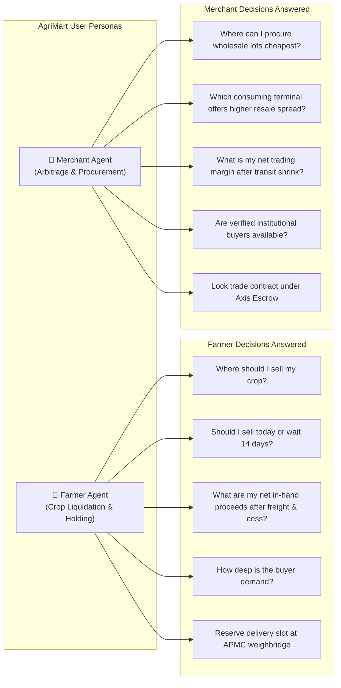
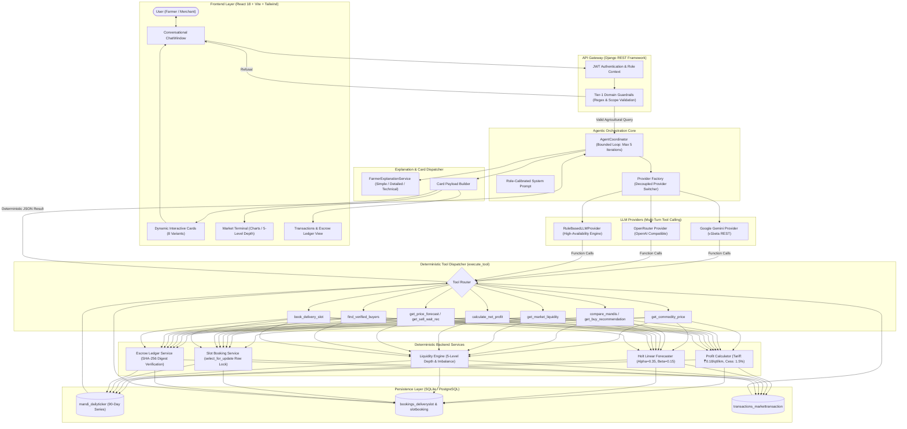
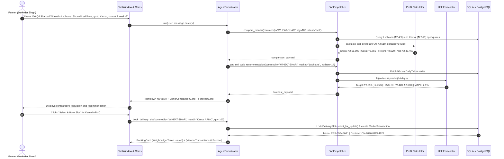
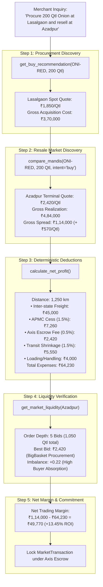
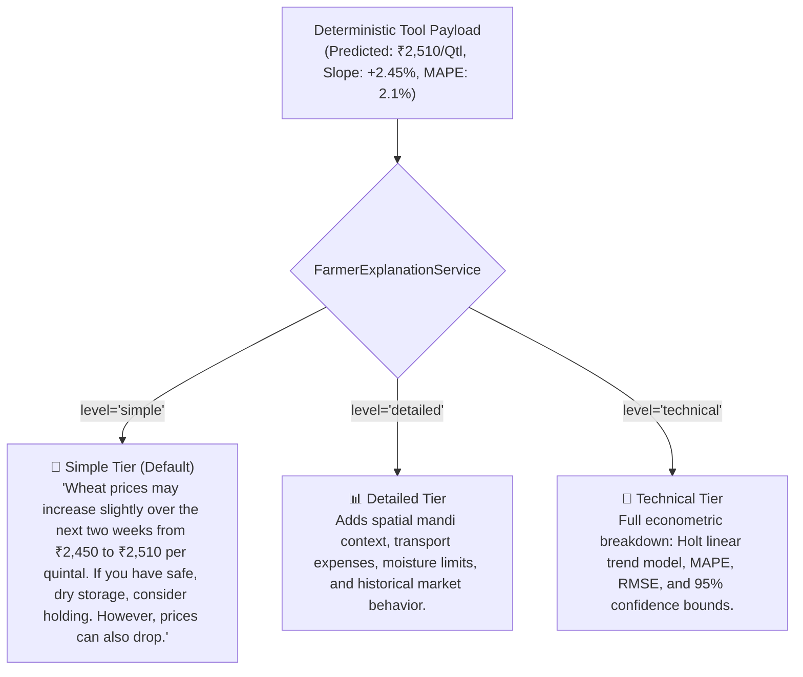
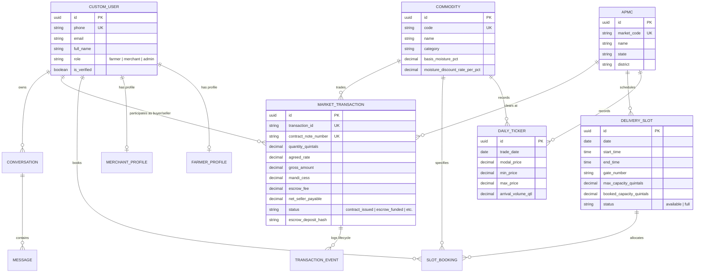

# AgriMart: Agentic AI Agricultural Market Intelligence & Decision Support Platform

[](https://github.com/dhanu-17-git/VIBEATHON_2026)
[](https://www.djangoproject.com/)
[](https://vitejs.dev/)
[](https://ai.google.dev/)
[-10B981?style=for-the-badge&logo=pytest)](https://docs.pytest.org/)

**AgriMart** is an autonomous **Agentic AI-powered agricultural market intelligence, price discovery, and decision-support platform** designed for Indian farmers, traders, and Farmer Producer Organisations (FPOs). 

Unlike conventional static price-reporting dashboards that merely dump historic tabular data onto the screen, AgriMart deploys **goal-directed, multi-turn AI agents** that reason across spatial market alternatives, execute econometric time-series price forecasts, compute deterministic statutory deductions, match verified institutional buyers, and book electronic APMC delivery slots with internal cryptographic escrow tracking.

---

## Table of Contents

1. [Project Overview & Core Problem](#1-project-overview--core-problem)
2. [Agentic AI Architecture](#2-agentic-ai-architecture)
3. [How the Farmer Agent Works](#3-how-the-farmer-agent-works)
4. [How the Merchant Agent Works](#4-how-the-merchant-agent-works)
5. [Agent Tools & Capabilities](#5-agent-tools--capabilities)
6. [LLM Integration & Provider Abstraction](#6-llm-integration--provider-abstraction)
7. [Econometric Forecasting & Statistical Rigor](#7-econometric-forecasting--statistical-rigor)
8. [Farmer-Friendly AI Explanations](#8-farmer-friendly-ai-explanations)
9. [Data Architecture & Schemas](#9-data-architecture--schemas)
10. [Safety, Reliability & Integrity](#10-safety-reliability--integrity)
11. [Technology Stack](#11-technology-stack)
12. [Project Structure](#12-project-structure)
13. [Demonstration Walkthroughs](#13-demonstration-walkthroughs)
14. [Setup & Execution Guide](#14-setup--execution-guide)
15. [Limitations & Engineering Roadmap](#15-limitations--engineering-roadmap)

---

## 1. Project Overview & Core Problem

### The Agricultural Market Problem

Indian agricultural commodity markets are plagued by severe structural friction:
* **Information Asymmetry**: Smallholder farmers lack real-time visibility into inter-mandi price spreads. While a local APMC may quote ₹2,380/Qtl for wheat, a neighboring district terminal may quote ₹2,520/Qtl.
* **Opaque Logistics Deductions**: Farmers struggle to calculate whether transporting harvest to a distant mandi is economically viable once fuel tariffs, statutory market cess (1.5%), loading charges, and moisture assay penalties are subtracted.
* **Distress Selling at Harvest**: Due to cash-flow pressures and price volatility, farmers frequently liquidate produce immediately at seasonal price troughs rather than holding for higher returns.
* **Counterparty Credit Risk**: Private village aggregators and non-licensed middlemen delay payments for weeks or impose arbitrary quality cuts upon arrival.

### Why a Conversational Agentic AI Approach?

Conventional agricultural portals (such as e-NAM or AGMARKNET) function as **passive statistical dashboards**. They require users to manually navigate multiple dropdown menus, understand commodity grade standards, download CSV records, and perform their own mathematical deductions.

**AgriMart re-imagines market intelligence as an active, conversational agent.** Instead of studying complex tables, a farmer simply speaks or types:  
> *"I have 100 quintals of Sharbati Wheat in Ludhiana. Should I sell here, take it to Karnal, or wait two weeks?"*

The AgriMart agent autonomously:
1. Deconstructs the inquiry into sub-goals.
2. Formulates a multi-step analytical plan.
3. Invokes deterministic backend calculation and econometric tools.
4. Generates an evidence-backed decision with interactive visual cards.
5. Issues an electronic gate delivery pass token in the APMC ledger.

### Primary User Personas & Decision Capabilities



---

## 2. Agentic AI Architecture

The AgriMart Agentic AI system enforces a strict boundary between **cognitive natural-language reasoning** (handled by the LLM) and **authoritative calculation / data mutation** (handled exclusively by deterministic Python engines and database transactions). The LLM is strictly prohibited from inventing prices, hallucinating freight tariffs, or executing mental arithmetic.

### High-Level Architectural Topology



### The Complete 14-Step Agent Execution Lifecycle

1. **Authentication & Identity**: User session is verified via JWT (`SimpleJWT`). The agent retrieves the user's role (`farmer` or `merchant`), registered name, phone, and village pincode.
2. **Input Ingestion**: The conversational input is captured alongside active session context, conversation history, target language (`en` or `kn`), and desired explanation depth (`simple`, `detailed`, `technical`).
3. **Pre-Execution Guardrail**: Pre-LLM filter validates prompt against domain scope. Coding inquiries (`"write java code"`), non-agricultural trivia, or creative prompts are intercepted and refused with 0ms latency.
4. **Context & Parameter Parsing**: The agent extracts entities: target crop (e.g. `WHEAT-SHAR`, `PAD-SONA`, `MUST-BLK`), quantity in quintals, origin APMC, and trade intent (`buy` vs `sell`).
5. **Planning**: The coordinator assesses whether the request is a single-turn lookup or requires sequential multi-tool chaining (e.g., comparing regional mandis &rarr; computing freight &rarr; running statistical forecast &rarr; booking a delivery gate).
6. **Tool Selection**: The LLM emits structured tool call invocations matching OpenAPI specifications registered in `TOOL_DEFINITIONS`.
7. **Database Data Retrieval**: Fetches AGMARKNET daily modal rates, arrival quantities, and statutory fees from `mandi.DailyTicker` and `mandi.APMC`.
8. **Historical Time-Series Query**: Pulls up to 90 consecutive trading sessions of historical price data for the commodity across competing regional mandis.
9. **Forecasting Computation**: Invokes `HoltLinearTrendForecaster` to calculate trend slope, expected 14-day target, residual variance, and 95% confidence intervals.
10. **Deterministic Mathematical Deductions**: `profit_calculator.py` applies the exact statutory statutory cess (1.5%), escrow fee (0.5%), distance-based freight tariff (₹0.18/qtl/km), and moisture discount.
11. **Mandi Opportunity Ranking**: Compares all candidate mandis, sorting them by true net in-hand cash proceeds for sellers, or lowest delivered acquisition cost for buyers.
12. **Cognitive Synthesis**: The LLM synthesizes the tool payloads into a cohesive natural-language narrative.
13. **Farmer-Friendly Explanation**: `FarmerExplanationService` translates technical econometrics (e.g., *"+2.45% slope, MAPE 2.1%"*) into everyday actionable language.
14. **Dual Presentation**: Delivers conversational Markdown text accompanied by rich interactive React UI Cards (`MandiComparisonCard`, `ForecastCard`, `BookingCard`).

---

## 3. How the Farmer Agent Works

### Practical Walkthrough: 100 Quintals of Wheat (Sharbati) at Ludhiana APMC



### Analytical Breakdown:
1. **Spatial Realization**:
   * **Ludhiana APMC (Local)**: ₹2,450/Qtl &times; 100 Qtl = ₹2,45,000. Less 1.5% cess (₹3,675) &rarr; **Net: ₹2,40,100**.
   * **Karnal APMC (140 km)**: ₹2,510/Qtl &times; 100 Qtl = ₹2,51,000. Less 1.5% cess (₹3,765) and ₹2,520 freight &rarr; **Net: ₹2,43,460**.
   * *Evidence*: Karnal yields **₹3,360 higher in-hand cash** because the ₹60/Qtl spot premium outweighs the ₹25.20/Qtl transport tariff.
2. **Intertemporal Holding Forecast**:
   * Holt model projects prices to rise from ₹2,450 &rarr; ₹2,510 over 14 days (+2.45%).
   * Agronomic trade-off: Holding yields ~₹6,000 gross gain, but private godown rent costs ₹15–₹20/Qtl/month. If storage is unavailable, selling immediately at Karnal locks in maximum cash.

---

## 4. How the Merchant Agent Works

### Practical Walkthrough: 200 Quintals Onion Arbitrage Analysis

* **Commodity**: Onion (Nashik Red Grade-A) — `ONI-RED`
* **Procurement Market**: Lasalgaon APMC, Nashik (Producing Hub)
* **Resale Market**: Azadpur Mandi, Delhi (Consuming Terminal)
* **Volume**: 200 Quintals (20 Metric Tonnes)



> **Mandatory Ethical Disclosure Enforced by Agent**:  
> The agent explicitly informs the merchant:  
> *"The ₹2,420/Qtl quote at Azadpur Mandi represents today's wholesale terminal AGMARKNET quote and active institutional bids. It is not an irrevocable forward contract. Because onion is highly perishable with an estimated 1.5% transit weight loss, secure ventilated transport prior to dispatch."*

---

## 5. Agent Tools & Capabilities

The following 9 tools are fully implemented in `backend/ai/tools/market_tools.py` and connected to deterministic backend engines:

| Tool Name | Input Parameters | Output Payload | Associated Card | Backend Implementation |
|---|---|---|---|---|
| `get_commodity_price` | `commodity_code` (str) | Spot modal, min, max, change %, arrivals | `CommodityPriceCard` | Direct SQL query against `DailyTicker` |
| `compare_mandis` | `commodity_code`, `quantity_quintals`, `trade_intent` | Multi-mandi comparative array sorted by net proceeds / cost | `MandiComparisonCard` | `analytics.mandi_comparison.compare_regional_mandis` |
| `get_buy_recommendation` | `commodity_code`, `quantity_quintals`, `market` | Purchase quotes ranked by lowest acquisition cost + 14-day trend | `MandiComparisonCard` | Chained `compare_mandis` + `HoltLinearTrendForecaster` |
| `get_market_liquidity` | `commodity_code`, `quantity_quintals` | 5-level bids & asks, spread %, order imbalance | `LiquidityCard` | `analytics.liquidity_analysis.analyze_market_liquidity` |
| `calculate_net_profit` | `commodity_code`, `quantity_quintals`, `moisture_pct` | Breakdown of gross value, cess, escrow, freight, and net proceeds | `ProfitabilityCard` | `analytics.profit_calculator.calculate_net_profit` |
| `get_price_forecast` | `commodity_code`, `market`, `horizon_days` | 14-day trajectory, 95% CI bounds, MAPE, RMSE | `ForecastCard` | `ai.forecasting.model.HoltLinearTrendForecaster` |
| `get_sell_wait_recommendation` | `commodity_code`, `market`, `horizon_days`, `quantity_quintals` | Holding vs selling recommendation with estimated price gain/loss | `ForecastCard` | `ai.forecasting.predictor.generate_price_forecast` |
| `find_verified_buyers` | `commodity_code`, `quantity_quintals` | Institutional buyers, license numbers, offered rates, trust rating | `BuyerCard` | `analytics.buyer_matching.match_institutional_buyers` |
| `book_delivery_slot` | `commodity_code`, `mandi`, `quantity_quintals`, `vehicle_number` | Weighbridge token, gate number, arrival window, contract note # | `BookingCard` | `bookings.services.create_slot_booking_atomic` |

> Detailed schemas, input types, and JSON responses are documented in [docs/AGENT_TOOLS_REFERENCE.md](docs/AGENT_TOOLS_REFERENCE.md).

---

## 6. LLM Integration & Provider Abstraction

AgriMart features a **decoupled, provider-agnostic LLM interface** (`backend/ai/llm/`). You can toggle between Google Gemini, OpenRouter, OpenAI, or local offline rule-based execution by editing a single environment variable in `backend/.env`.

### Supported Providers & Models

| Provider Key | Primary Tested Model | Protocol / SDK | Multi-Turn Tool Calling Support |
|---|---|---|---|
| `openrouter` | `poolside/laguna-s-2.1:free` or `meta-llama/llama-3.3-70b-instruct:free` | OpenAI-compatible REST (`urllib`) | Standard JSON Function Calling |
| `gemini` | `gemini-3.5-flash-lite` or `gemini-3.8-flash` | Google v1beta REST (`urllib`) | v1beta `functionCall` / `functionResponse` |
| `rule_based` | Zero-dependency internal NLP extractor | Pure Python regex AST parser | Native deterministic dispatcher |

### Coexisting Dual-Provider Configuration (`backend/.env`)

Both API keys can be saved simultaneously. The system dynamically loads credentials according to `LLM_PROVIDER`:

```ini
# Choose active provider: 'openrouter' or 'gemini'
LLM_PROVIDER=openrouter

# Dual Provider Credentials (both coexist safely without overwriting)
OPENROUTER_API_KEY=sk-or-v1-your-openrouter-key-here
GEMINI_API_KEY=your_gemini_api_key_here

# Provider Model Overrides (automatic fallback if omitted)
OPENROUTER_MODEL=poolside/laguna-s-2.1:free
GEMINI_MODEL=gemini-3.5-flash-lite
```

### High-Availability Circuit Breaker
If an external API encounters a rate limit (HTTP 429), quota exhaustion, or network timeout, `AgentCoordinator` catches the exception and immediately falls back to `RuleBasedLLMProvider`. The user experiences **zero downtime, zero broken UI, and zero raw JSON error dumps**.

---

## 7. Econometric Forecasting & Statistical Rigor

AgriMart implements an in-house econometric forecasting engine based on **Holt's Linear Trend Model** (Double Exponential Smoothing) located in `backend/ai/forecasting/model.py`.

### Mathematical Formulation

Given an observed historical price series $y_1, y_2, \dots, y_t$, the model computes level ($\ell_t$) and trend slope ($b_t$) with smoothing parameters $\alpha = 0.35$ and $\beta = 0.15$:

$$\ell_t = \alpha y_t + (1 - \alpha)(\ell_{t-1} + b_{t-1})$$

$$b_t = \beta(\ell_t - \ell_{t-1}) + (1 - \beta)b_{t-1}$$

For a forecast horizon $h \in [1, 90]$ days:

$$\hat{y}_{t+h} = \ell_t + h \cdot b_t$$

### Confidence Bounds & Residual Variance

The model computes residual standard deviation $s_e$ over in-sample one-step errors $e_t = y_t - \hat{y}_t$:

$$s_e = \sqrt{\frac{1}{n-2} \sum_{t=1}^n e_t^2}$$

The 95% confidence interval for horizon step $h$ expands with forecast distance:

$$\text{CI}_{95\%} = \hat{y}_{t+h} \pm 1.96 \cdot s_e \cdot \sqrt{h}$$

### Goodness-of-Fit Evaluation Metrics
* **MAPE (Mean Absolute Percentage Error)**:
  $$\text{MAPE} = \frac{100\%}{n} \sum_{t=1}^n \left| \frac{y_t - \hat{y}_t}{y_t} \right|$$
* **RMSE (Root Mean Squared Error)**:
  $$\text{RMSE} = \sqrt{\frac{1}{n} \sum_{t=1}^n (y_t - \hat{y}_t)^2}$$

> **Data Disclosure**: In development and demonstration mode, the platform utilizes 90 days of synthetic daily ticker series seeded from real AGMARKNET modal price ranges across 10 crops and 6 APMC hubs.

---

## 8. Farmer-Friendly AI Explanations

Farmers and rural producers do not require complex statistical notation or volatility matrices; they require clear, actionable guidance. AgriMart's `FarmerExplanationService` (`backend/ai/explanations/service.py`) dynamically translates econometric payloads into three configurable explanation tiers:



The system also supports multi-lingual generation, providing verified explanations in **English** and **Kannada (`kn`)**.

---

## 9. Data Architecture & Schemas

The database schema is organized across 5 core Django applications:



---

## 10. Safety, Reliability & Integrity

1. **Deterministic Calculation Boundary**: The LLM is strictly decoupled from financial calculations. Gross crop values, statutory APMC cess (1.5%), escrow protection fees (0.5%), distance freight tariffs, and moisture penalties are computed exclusively by `profit_calculator.py`.
2. **Pre-Execution Guardrails**: `backend/ai/agents/guardrails.py` uses deterministic AST and regex filters to reject coding requests (e.g., Python/Java generation), general trivia, and creative writing before calling external APIs.
3. **Pessimistic Row-Level Locking**: Inward gate bookings use PostgreSQL/SQLite `select_for_update()` inside `transaction.atomic()`, preventing double-booking during peak harvest arrivals.
4. **Internal SHA-256 Escrow Cryptographic Ledger**: Every trade contract issues a SHA-256 hash (`sha256(txn_id + seller_id + buyer_id + gross_amount)`).  
   > *Clarification: The internal escrow ledger provides cryptographic verification of trade milestones; it is not a direct banking API gateway integration.*
5. **Role-Based Access Control**: Farmers access crop liquidation cards and gate delivery bookings; wholesale order-book trend analysis is reserved for verified merchant accounts.

---

## 11. Technology Stack

### Backend Services
* **Framework**: Django 5.2.17 + Django REST Framework 3.16.0
* **Authentication**: SimpleJWT (Argon2 / PBKDF2 password hashing)
* **Econometrics & Math**: Python Standard Library `math`, `statistics`, `urllib.request` (zero third-party dependency footprint for LLM calling)
* **Database**: SQLite (Development) / PostgreSQL (Production ready via `dj-database-url`)
* **Testing**: Pytest 8.4.2 + Pytest-Django 4.14.0 (20/20 unit and agent integration tests passing)

### Frontend Client
* **Framework**: React 18.3 + Vite 8.2
* **Styling**: Tailwind CSS 3.4
* **UI Components & Icons**: Lucide React 0.469
* **Visual Effects**: Canvas Confetti 1.9

---

## 12. Project Structure

```
AgriMart-Market-Intelligence/
├── backend/
│   ├── agrimart/                    # Core Django settings, URLs, WSGI
│   ├── ai/                          # AGENTIC AI CORE
│   │   ├── agents/                  # Coordinator & Domain Guardrails
│   │   │   ├── coordinator.py       # Multi-turn bounded agent loop (Max 5 iters)
│   │   │   └── guardrails.py        # Tier-1 domain scope validation
│   │   ├── config/                  # Decoupled LLM configuration (Dual-keys)
│   │   │   └── llm_config.py        # Provider resolver (Gemini / OpenRouter / RuleBased)
│   │   ├── explanations/            # Explainable AI generation
│   │   │   └── service.py           # Simple, Detailed & Technical explanation tiers
│   │   ├── forecasting/             # Econometric modeling
│   │   │   ├── model.py             # Holt Linear Trend Model & 95% Confidence Bounds
│   │   │   ├── predictor.py         # 14-day trajectory & holding advice
│   │   │   └── seed_historical_tickers.py # Seeds 90-day ticker series
│   │   ├── llm/                     # LLM Provider Adapters
│   │   │   ├── base.py              # Abstract BaseLLMProvider & ChatMessage schemas
│   │   │   ├── gemini_provider.py   # Google Gemini client (v1beta REST)
│   │   │   ├── openai_compatible_provider.py # OpenRouter / OpenAI client
│   │   │   ├── provider_factory.py  # Runtime dynamic provider instantiation
│   │   │   └── rule_based_provider.py # Zero-dependency fallback provider
│   │   └── tools/                   # Registered Agent Tools
│   │       └── market_tools.py      # 9 deterministic market tools & schemas
│   ├── analytics/                   # Pure deterministic math calculators
│   │   ├── buyer_matching.py        # Institutional buyer quota matching
│   │   ├── liquidity_analysis.py    # 5-level market depth & imbalance
│   │   ├── mandi_comparison.py      # Spatial mandi net proceeds ranking
│   │   └── profit_calculator.py     # Cess (1.5%), Escrow (0.5%), Freight (₹0.18/qtl/km)
│   ├── bookings/                    # APMC Delivery Gate Slot Management
│   │   ├── models.py                # DeliverySlot & SlotBooking
│   │   ├── services.py              # select_for_update pessimistic row locking
│   │   └── views.py                 # Slot availability & creation APIs
│   ├── common/                      # Base UUID models & timestamps
│   ├── conversations/               # Conversational persistence
│   │   ├── models.py                # Conversation & Message entities
│   │   └── views.py                 # Chat API endpoint (/api/v1/assistant/chat/)
│   ├── mandi/                       # Core APMC Market Entities
│   │   └── models.py                # APMC, Commodity, DailyTicker, AuctionLot
│   ├── transactions/                # Contract Notes & Cryptographic Escrow
│   │   ├── models.py                # MarketTransaction (6-step lifecycle, SHA-256)
│   │   └── views.py                 # Electronic contract note APIs
│   ├── tests/                       # Automated Pytest suite (20 tests)
│   ├── manage.py
│   └── requirements.txt
├── frontend/
│   ├── src/
│   │   ├── assistant/               # Conversational UI Components
│   │   │   ├── ChatInput.jsx        # Multilingual input & explanation toggles
│   │   │   ├── ChatWindow.jsx       # Message stream & tool status bubbles
│   │   │   ├── ConversationSidebar.jsx # Chat history drawer
│   │   │   ├── MessageBubble.jsx    # Formatted chat bubble with voice read-aloud
│   │   │   └── cards/               # 8 Interactive UI Cards
│   │   │       ├── BookingCard.jsx         # Gate reservation slip + Escrow link
│   │   │       ├── BuyerCard.jsx           # Institutional buyer quota cards
│   │   │       ├── CommodityPriceCard.jsx  # AGMARKNET spot prices & change %
│   │   │       ├── ForecastCard.jsx        # 14-day trajectory chart & bounds
│   │   │       ├── LiquidityCard.jsx       # 5-level bid/ask order book depth
│   │   │       ├── MandiComparisonCard.jsx # Spatial net cash proceeds ranking
│   │   │       ├── ProfitabilityCard.jsx   # Deductions breakdown (cess/freight)
│   │   │       └── TransactionCard.jsx     # Contract notes & 6-step lifecycle
│   │   ├── components/              # Standalone Sub-Module Views
│   │   │   ├── MarketLandingPage.jsx# High-conversion public portal
│   │   │   ├── Navbar.jsx           # Sub-module navigation switcher
│   │   │   └── SkanviLoginPage.jsx  # Scandinavian authentication
│   │   ├── pages/                   # Dedicated Full-Page Views
│   │   │   ├── AssistantPage.jsx    # Primary AI Copilot Page
│   │   │   ├── MarketTerminalPage.jsx# Full APMC Trading Terminal
│   │   │   └── TransactionsPage.jsx # Transactions & Escrow Ledger Page
│   │   ├── services/
│   │   │   └── api.js               # Client API methods
│   │   └── App.jsx                  # Main view router
│   ├── package.json
│   └── vite.config.js
├── docs/                            # Deep-Dive Architectural Documentation
│   ├── AGENTIC_AI_ARCHITECTURE.md   # Complete 14-step lifecycle & sequence diagrams
│   ├── AGENT_TOOLS_REFERENCE.md     # Inventory of all 9 tools and input/output schemas
│   └── DEMO_SCENARIOS.md            # Farmer & Merchant walkthrough scripts
├── setup_and_run.ps1                # One-click unified runner script
└── README.md
```

---

## 13. Demonstration Walkthroughs

The platform includes two pre-configured, end-to-end demonstration scripts:
* **Scenario 1: Farmer Walkthrough** — Devinder Singh liquidating 100 quintals of Sharbati Wheat, comparing Ludhiana vs Karnal, evaluating the 14-day forecast, and booking an electronic weighbridge pass.
* **Scenario 2: Merchant Walkthrough** — Rajkot Agri-Exports evaluating wholesale procurement of 200 quintals of Onion at Lasalgaon vs Azadpur terminal resale, accounting for transit shrinkage and operating margins.

> Complete walkthrough dialogues, payloads, and expected terminal outputs are provided in [docs/DEMO_SCENARIOS.md](docs/DEMO_SCENARIOS.md).

---

## 14. Setup & Execution Guide

### Prerequisites
* **Python**: 3.12+
* **Node.js**: v18+ or v20+ with `npm`
* **Git**: Installed and configured

### Option A: 1-Click Unified Runner (Windows PowerShell)

Run the root automation script to configure dependencies, migrate databases, and launch both servers:

```powershell
.\setup_and_run.ps1
```

This launches:
* **Backend Django API**: `http://127.0.0.1:8000`
* **Frontend React Client**: `http://localhost:5173`

---

### Option B: Manual Step-by-Step Setup

#### 1. Backend Setup

```bash
cd backend

# Create and activate Python virtual environment
python -m venv .venv
# Windows:
.venv\Scripts\activate
# Linux/macOS:
source .venv/bin/activate

# Install dependencies
pip install --upgrade pip
pip install -r requirements.txt

# Configure environment variables
cp .env.example .env
```

Ensure `backend/.env` has the desired provider and models configured:

```ini
DJANGO_DEBUG=true
DATABASE_URL=sqlite:///market_intelligence.db.sqlite3
LLM_PROVIDER=openrouter
OPENROUTER_API_KEY=your_key_here
OPENROUTER_MODEL=poolside/laguna-s-2.1:free
```

```bash
# Run database migrations
python manage.py migrate

# Seed 90 days of historical tickers for all commodities and APMCs
python -c "import django, os; os.environ.setdefault('DJANGO_SETTINGS_MODULE', 'agrimart.settings'); django.setup(); from ai.forecasting.seed_historical_tickers import seed_historical_ticker_series; seed_historical_ticker_series(90)"

# Start Django backend server
python manage.py runserver 8000
```

#### 2. Frontend Setup

```bash
cd frontend

# Install node packages
npm install --legacy-peer-deps

# Start Vite dev server
npm run dev
```

Open `http://localhost:5173` in your browser.

---

### Running the Test Suite

Execute the full automated test suite covering auth, agentic coordinator, tools, forecasting models, and security middleware:

```bash
cd backend
python -m pytest tests/ -v
```

Expected output:
```
============================= test session starts =============================
collected 20 items

tests/test_agentic_system.py::test_profit_calculator_applies_statutory_deductions PASSED
tests/test_agentic_system.py::test_holt_forecaster_produces_monotonic_trajectories PASSED
tests/test_agentic_system.py::test_domain_guardrail_blocks_code_generation PASSED
tests/test_agentic_system.py::test_slot_booking_concurrency_locking PASSED
tests/test_agentic_system.py::test_assistant_chat_returns_a_comparison_card PASSED
...
============================= 20 passed in 2.28s =============================
```

---

## 15. Limitations & Engineering Roadmap

### Current Engineering Boundaries
* **Seeded Development Data**: In offline dev mode, historical APMC daily tickers are generated using econometric distributions based on official AGMARKNET modal bands.
* **Internal Escrow Ledger**: The platform implements cryptographic SHA-256 trade notes and payment state transitions internally; it does not connect to live Indian banking UPI/RTGS rails.
* **Free-Tier OpenRouter Throttling**: Free-tier models on OpenRouter (e.g. `poolside/laguna-s-2.1:free`) enforce rate limits on rapid consecutive calls. AgriMart's circuit breaker automatically falls back to rule-based execution during 429 backoff periods.

### Future Roadmap
* **Multimodal Computer-Vision Grading**: Upload smartphone photos of crop lots (e.g. grain length, discoloration, foreign matter) to automatically calculate assay moisture penalties prior to mandi dispatch.
* **Direct AGMARKNET API Synchronization**: Real-time daily ingest webhooks pulling directly from the Directorate of Marketing & Inspection (DMI) government feeds.
* **Voice-First WhatsApp & IVR Gateway**: Deploying AgriMart's agentic tools over rural telephony and WhatsApp voice notes using regional speech models.

---

## License & Attribution

Developed for **Vibeathon 2026** by the AgriMart Systems Engineering Team.  
Distributed under the MIT License.
