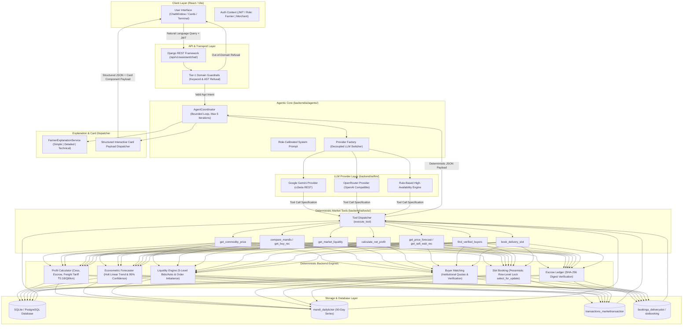
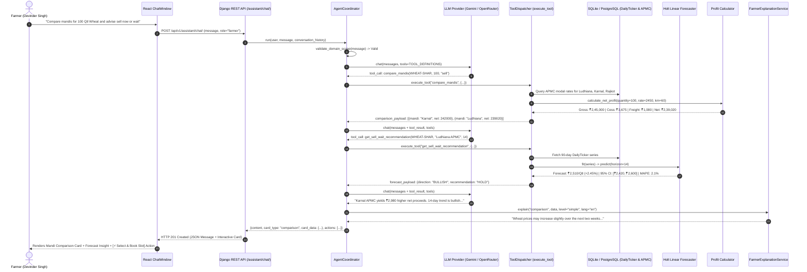
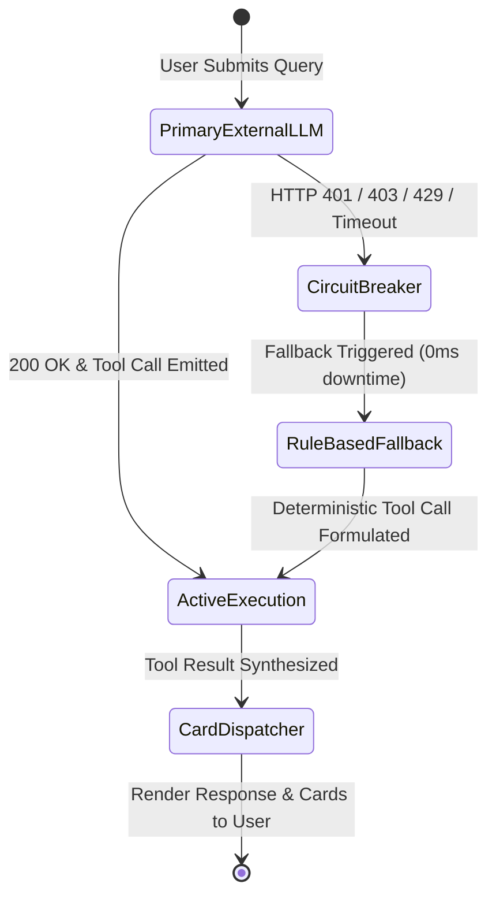

# AgriMart Agentic AI Architecture & Execution Lifecycle

This document provides a comprehensive technical specification of the **Agentic AI Architecture** powering AgriMart's Agricultural Market Intelligence and Decision-Support Platform. It details the complete 14-step execution lifecycle, agent orchestration, multi-turn tool calling, deterministic calculation boundaries, domain guardrails, and explainable AI generation.

---

## 1. High-Level Architectural Topology

AgriMart separates natural-language cognitive reasoning from mission-critical financial and econometric computations. The Large Language Model (LLM) acts as an **orchestrator and natural-language interface**, while deterministic backend engines execute all mathematical deductions, historical time-series forecasting, market depth analysis, and transactional locking.

### End-to-End System Diagram



---

## 2. The 14-Step Agent Execution Lifecycle

Every user query submitted to AgriMart passes through a strictly bounded, deterministic 14-step execution pipeline:

```
[1. User Auth] ──> [2. Query Ingestion] ──> [3. Guardrail Check] ──> [4. Context Extraction]
                                                                              │
┌─────────────────────────────────────────────────────────────────────────────┘
▼
[5. Plan Analysis] ──> [6. Tool Selection] ──> [7. DB Data Fetch] ──> [8. Historical Analysis]
                                                                              │
┌─────────────────────────────────────────────────────────────────────────────┘
▼
[9. Forecasting] ──> [10. Deterministic Math] ──> [11. Mandi Ranking] ──> [12. LLM Synthesis]
                                                                              │
┌─────────────────────────────────────────────────────────────────────────────┘
▼
[13. Evidence Construction] ──> [14. Interactive Card Delivery]
```

### Detailed Lifecycle Stages

| Step | Stage Name | Technical Operation | Relevant Codebase File |
|---|---|---|---|
| **1** | **User Authentication & Role Identification** | Validates JWT bearer token, resolving user persona (`farmer`, `merchant`, `admin`) and geographical origin pincode. | `backend/users/models.py`, `backend/conversations/views.py` |
| **2** | **Natural-Language Input Ingestion** | Captures user prompt, target conversation ID, selected language (`en`, `kn`), and explanation depth level (`simple`, `detailed`, `technical`). | `backend/conversations/views.py` |
| **3** | **Pre-Execution Guardrail Validation** | Tier-1 domain boundary filter validates prompt against agricultural domain dictionaries. Rejects software coding (Java/Python), creative writing, and out-of-scope queries prior to LLM invocation. | `backend/ai/agents/guardrails.py` |
| **4** | **Context & Parameter Extraction** | Extracts semantic entities: crop variety (e.g. `WHEAT-SHAR`, `PAD-SONA`), volume in quintals, target mandi, and trade intent (`buy` vs `sell`). | `backend/ai/llm/rule_based_provider.py` |
| **5** | **Analysis Planning** | Formulates plan: identifies whether the query requires price retrieval, spatial mandi comparison, order depth, forecasting, or delivery gate reservation. | `backend/ai/agents/coordinator.py` |
| **6** | **Tool Selection** | LLM outputs structured function call matching OpenAPI-compatible schemas registered in `TOOL_DEFINITIONS`. | `backend/ai/tools/market_tools.py` |
| **7** | **Database Retrieval** | Fetches live APMC modal prices, statutory mandi cess rates, operational godowns, and assay moisture benchmarks. | `backend/mandi/models.py` |
| **8** | **Historical Observation Analysis** | Queries up to 90 consecutive daily trading session tickers (`DailyTicker`) to calculate rolling volatility, minimum, maximum, and median prices. | `backend/ai/forecasting/data_loader.py` |
| **9** | **Econometric Forecasting** | Fits Holt's linear double exponential smoothing model to compute 14-day trajectory, 95% confidence intervals, and MAPE/RMSE goodness-of-fit metrics. | `backend/ai/forecasting/model.py` |
| **10** | **Deterministic Financial Deductions** | Pure algorithmic deduction: calculates gross harvest value, APMC cess (1.5%), Axis escrow fee (0.5%), freight tariffs (₹0.18/qtl/km), and moisture penalty. LLM is strictly forbidden from doing math. | `backend/analytics/profit_calculator.py` |
| **11** | **Mandi Opportunity Ranking** | Compares competing APMC markets by true net in-hand realization (for sellers) or lowest total acquisition cost (for buyers). | `backend/analytics/mandi_comparison.py` |
| **12** | **Cognitive Synthesis & Explanation** | LLM evaluates backend payload and produces natural-language narrative strictly bounded by the deterministic facts. | `backend/ai/agents/coordinator.py` |
| **13** | **Evidence & Grounding Construction** | Formulates explainable reasoning: cites specific freight differentials, confidence bounds, and storage trade-offs in farmer-friendly language. | `backend/ai/explanations/service.py` |
| **14** | **Interactive Card Delivery** | Synthesizes response into dual presentation: conversational text narrative + dynamic React component card (e.g. `CommodityPriceCard`, `BookingCard`, `TransactionCard`). | `frontend/src/assistant/cards/` |

---

## 3. Sequence Diagram: Farmer Decision Workflow

The sequence below illustrates a farmer inquiring: *"Compare mandis for 100 quintals of Sharbati Wheat and advise whether to sell now or wait"*.



---

## 4. Multi-Turn State Management & Tool Calling Protocols

AgriMart maintains conversations through `Conversation` and `Message` models in PostgreSQL/SQLite.

### 1. Loop Prevention & Iteration Budget
Agent execution is bounded by `MAX_TOOL_ITERATIONS = 5`. If an LLM repeatedly invokes tools without concluding, the coordinator aborts the loop and returns a safe fallback message with the latest compiled card data.

### 2. Google Gemini v1beta Format Compatibility
Google's Gemini API enforces unique multi-turn REST constraints:
* **Function Call Role**: The model emits function calls under `role: "model"`.
* **Function Response Role**: Tool execution outputs must be echoed back under `role: "user"` using the structure:
  ```json
  {
    "role": "user",
    "parts": [{
      "functionResponse": {
        "name": "compare_mandis",
        "response": {"output": { ... }}
      }
    }]
  }
  ```
* **Thought Signature Preservation**: When Gemini 2.5/3.5 generates tool calls, it attaches internal encrypted `thought_signature` tokens. AgriMart preserves `raw_parts` verbatim in `ChatMessage` and `LLMResponse`, preventing HTTP 400 Bad Request errors on subsequent conversation turns.

### 3. OpenRouter / OpenAI Compatible Format
For OpenRouter and OpenAI models:
* Tool definitions follow the standard JSON Schema `type: "function"` structure.
* Tool call responses are fed back as `role: "tool"` with matching `tool_call_id`.
* Required HTTP headers (`HTTP-Referer` and `X-Title: AgriMart Market Intelligence`) are injected for analytics and model routing.

---

## 5. Resilience & Circuit-Breaker Architecture

If commercial APIs experience outages, rate limits (HTTP 429), or invalid credentials, AgriMart triggers its internal circuit breaker:



1. **Error Interception**: `AgentCoordinator` wraps LLM communication in a try-catch block inspecting error substrings (`"encountered an error"`, `"API key not valid"`, `"401"`, `"403"`, `"429"`).
2. **Deterministic Fallback**: The coordinator instantiates `RuleBasedLLMProvider(self.provider.config)`, formulating exact tool calls using regex entity parsing.
3. **Zero UI Disruption**: The farmer always receives verified APMC market cards, price forecasts, and booking tokens, regardless of external cloud API status.
